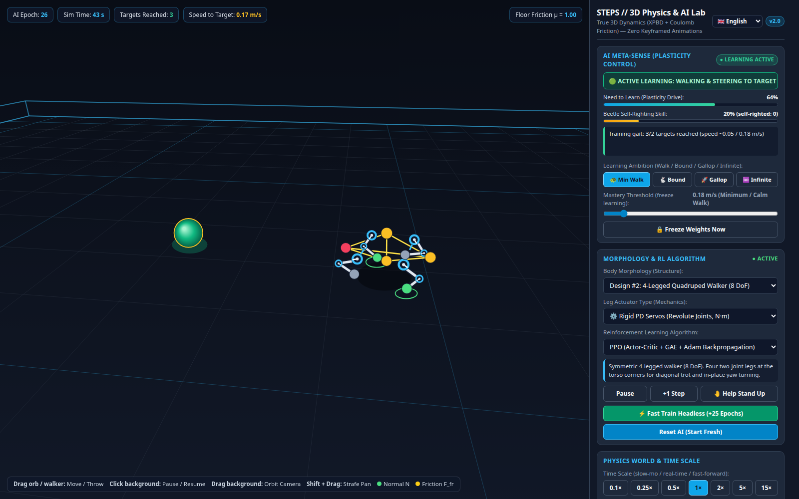

# STEPS // 3D Physics & AI Lab

[](https://aminadav-ai.github.io/steps/)
[](https://github.com/aminadav-ai/steps/releases/tag/v2.0.0)
[](#1-first-principles-3d-physics-engine--dual-actuator-mechanics)
[](#2-reinforcement-learning--neural-architecture)
[-ec4899?style=for-the-badge)](#6-multilingual-interface--per-user-persistence)
[](./LICENSE)

> **🌐 Live Interactive Laboratory:** **[https://aminadav-ai.github.io/steps/](https://aminadav-ai.github.io/steps/)**



**STEPS** is an interactive, zero-dependency 3D physics and reinforcement learning laboratory running directly in the browser. Multi-legged walkers (**6-DoF Tripod** and **8-DoF Quadruped**) learn from scratch in real time how to coordinate either **Rigid Revolute PD Servos** or **Soft Bio-Muscles**, push against the floor using true Coulomb friction, steer toward food targets, and self-right when overturned—with **zero keyframed animations or hidden external forces**.

---

## 🆕 What's New in v2.0

1. **Dual Leg Actuator Architecture (`⚙️ Rigid PD Servos` vs `💪 Soft Bio-Muscles`):**
   - Switch live between **Rigid Revolute PD Servos (`servo`, default in v2.0)** with metallic links, cantilevered 3D hip shafts, rotary joint drums, and real-time torque telemetry ($\text{N}\cdot\text{m}$), or classic **Soft Bio-Muscles (`muscle`, v1.0)** with spring-damper tendons ($\text{W}$).
2. **Planar Sagittal Knee Bearings & Mechanical Joint Hard-Stops:**
   - **Outboard Cantilevered Hip Shafts** eliminate chassis-leg collisions and provide true 3D lateral moment arms.
   - **Zero-Momentum Mechanical Hard-Stops** (`sum m_i dx_i === 0`) enforce physical Hip Ventral limits and Knee `"Ʌ"` Anti-Hyperextension stops so legs never invert into unnatural backward `"V"` bends even under violent high-speed throws.
3. **Stabilized 8-DoF Quadruped & Balanced 6-DoF Tripod:**
   - Widened Quadruped stance (`x = ±0.23 m`, `z = ±0.28 m`) with a heavy low-keel center of mass (`0.88 kg` at `y = 0.14 m`) prevents nose-dives during `Bound` and `Gallop` regimes, while self-inflicted overturns receive a direct PPO GAE termination penalty (`r -= 1.65`, `done = 1`).
4. **Biological Two-Phase Beetle Self-Righting Reflex with Confirmation & Rest Pauses:**
   - **Initial `1.0 s` Confirmation Pause on Back:** Allows dynamic somersaults and mid-air rolls toward the target without false reflex triggers.
   - **Inter-Attempt `0.4 s` Rest Pauses:** Just like a live beetle, if an overturning heave does not immediately succeed, the walker pauses briefly on its back to damp parasitic momentum before its next synchronized push.
5. **Strict Skill Consolidation (`CONSOLIDATED`):**
   - Once the walker reaches the mastery speed threshold and target count, synaptic weights lock permanently—staying frozen across target respawns, 180° turns, and manual orb dragging—and only resume training upon explicit user action (clicking **Unfreeze**, changing **Floor Friction**, or raising **Learning Ambition**).

---

## ✨ Key Scientific & Engineering Highlights

### 1. First-Principles 3D Physics Engine & Dual Actuator Mechanics (`200 Hz` Symplectic Euler + XPBD)
- **Strict Conservation of Linear & Angular Momentum:** Every servo and muscle acts strictly through internal pairwise equal-and-opposite forces ($\vec{F}_{ij} = -\vec{F}_{ji}$) and zero-net-impulse XPBD projections ($\sum m_i \Delta \vec{x}_i = \vec{0}$). On a frictionless floor ($\mu = 0.00$), vigorous leg actuation produces **zero center-of-mass drift** down to machine precision (`~1.2e-13 m`).
- **True Coulomb Friction Cone & Normal Impulse:** Locomotion emerges exclusively from ground normal reaction forces ($\vec{N}$) and tangential static/dynamic friction ($\|\vec{F}_{\text{fr}}\| \le \mu \|\vec{N}\|$), visualized live on every foot contact.
- **Sagittal Planar Knee Bearings & Mechanical Hard-Stops:** Custom 3-node coplanar projections keep each leg flexing cleanly in its sagittal plane while mechanical hard-stops prevent knee hyperextension and hip snap-through.

### 2. Reinforcement Learning & Neural Architecture
- **31-Dimensional Proprioceptive & Exteroceptive Observation Space:**
  - Target heading ($\cos\alpha$, $\sin\alpha$) and distance in the creature's local torso frame;
  - Local 3D torso velocity, orientation vectors, angular rates, and foot contact sensors;
  - Central Pattern Generator (CPG) phase oscillators ($\sin\omega t$, $\cos\omega t$) and sensory-gated steering channels.
- **Actor-Critic Network (`31 → 32 → 24 → 6/8` + Direct CPG Skip-Synapses):**
  - Trained live via **PPO (Proximal Policy Optimization + Generalized Advantage Estimation + Adam Backpropagation)** or **SEP-CMA-ES / Natural Evolution Strategies**.
  - Live interactive neural network visualizer displaying firing activations, skip-connection weights, and Critic value estimates $V(s)$.

### 3. Homeostatic Meta-Plasticity Sense ("AI Meta-Sense")
- The creature continuously monitors its own locomotion competence to decide **when to learn and when to consolidate**:
  - **Active Learning (`LEARNING_WALK`):** Adapts synaptic weights until the target speed threshold and target collection count are achieved.
  - **Strict Skill Consolidation (`CONSOLIDATED`):** Automatically freezes neural weights and stops the AI epoch counter once mastery is reached, protecting the learned gait from catastrophic forgetting.
  - **4 Ambition Regimes:** `🐢 Min Walk` (`0.18 m/s`), `🐇 Bound` (`0.34 m/s`), `🚀 Gallop` (`0.48 m/s`), and `♾️ Infinite` (`100%` continuous plasticity). Raising the ambition threshold or altering floor friction immediately wakes up training to master a faster gait.

### 4. Two-Phase Biological Beetle Self-Righting Reflex ("Рефлекс жука")
- If the creature lands upside down on its back (`up.y < 0.22`) and remains overturned for `1.0 s` (`20` control steps), it pauses walking updates—protecting its walking memory—and enters **`🪲 LEARNING_RIGHTING`**.
- Using a coordinated two-phase righting reflex (folding legs opposite the roll side while planting the floor-side lever leg), it heaves its torso past vertical (`up.y > 0.58`), pausing `0.4 s` between attempts if needed until upright stance is restored.

### 5. Direct 3D Mouse Manipulation & Time Control
- **Grab, Move, or Throw the Walker:** Drag the creature directly in 3D space or toss it onto its back to test its mechanical hard-stops and self-righting reflex.
- **Move the Target Orb:** Drag the emerald target orb anywhere on the arena floor in real time without disturbing consolidated neural weights.
- **3-Phase Target Lifecycle:** Reached targets dissolve over `1.0 s`, pause for `1.0 s`, and drop from the sky with gravity and bounce over `1.0 s`.
- **Time Scale & Bounded Headless Fast-Train:** Observe mechanics in `0.1×` slow motion, `1×` real time, up to `15×` fast-forward, or run `+25 Epochs` instantaneously without rendering.

### 6. Multilingual Interface & Per-User Persistence
- **8 Built-in Languages (<30 KB static dictionary, 0% physics overhead):**
  - Automatically detects your browser language (`navigator.languages`) with **English (`en`)** as the universal fallback.
  - Instant switching between **🇬🇧 English**, **🇷🇺 Русский**, **🇮🇱 עברית (with native RTL layout)**, **🇪🇸 Español**, **🇩🇪 Deutsch**, **🇫🇷 Français**, **🇨🇳 中文**, and **🇯🇵 日本語**.
- **Per-User Browser Persistence (`localStorage`):**
  - Each visitor's creature, neural network weights, morphology (`tripod` / `quadruped`), actuator mode (`servo` / `muscle`), ambition setting, and language preference are automatically saved in their own browser's `localStorage` (`steps_saved_creature_v2`, `steps_lang_v1`) and restored upon page reload.

---

## 🚀 Quick Start (Local Development)

**Prerequisites:** [Node.js](https://nodejs.org/) v18+ (no external `npm install` packages required—100% pure ES modules).

```bash
# 1. Clone the repository
git clone https://github.com/aminadav-ai/steps.git
cd steps

# 2. Start the local server (serves at http://localhost:3000)
npm start

# 3. Run the automated physics & RL verification suite
npm test
```

---

## 🗂️ Project Structure

```text
steps/
├── index.html                        # Main application layout & 8-language selector (v2.0)
├── styles.css                        # Responsive dark/light scientific UI (CSS Logical Properties + RTL)
├── server.js                         # Zero-dependency Node HTTP server & local experiment archiver
├── src/
│   ├── main.js                       # Application loop, HUD telemetry, localStorage & i18n controller
│   ├── i18n/
│   │   └── translations.js           # Complete dictionary for EN, RU, HE (RTL), ES, DE, FR, ZH, JA
│   ├── physics/
│   │   ├── Vec3.js                   # Allocation-free 3D vector math
│   │   ├── PhysicsEngine3D.js        # 200 Hz Symplectic Euler + XPBD constraints + Coulomb friction
│   │   └── ArenaSimulation.js        # Arena environment, target lifecycle, checkpoints & rewards
│   ├── morphologies/
│   │   └── Morphologies.js           # Tripod (6 DoF) & Quadruped (8 DoF) with Revolute PD Servos & Bio-Muscles
│   ├── brains/
│   │   └── NeuralRL.js               # Actor-Critic MLP, PPO+GAE+Adam, SEP-CMA-ES, Meta-Sense & Beetle Reflex
│   ├── render/
│   │   ├── Renderer3D.js             # Custom 3D perspective renderer, servo drums, raycasting & force vectors
│   │   └── TelemetryRenderers.js     # Real-time Neural Network graph & Learning Dynamics chart
│   └── logging/
│       └── ExperimentLogger.js       # Telemetry logger (auto-switches to static mode on GitHub Pages)
└── tests/
    └── verify_physics_and_rl.js      # Automated verification of momentum conservation, Servos, PPO & self-righting
```

---

## 🌿 Branches & Releases
- **`main` / `v2-dev` / `release/v2.0` (`v2.0.0`):** Current main release featuring Dual Actuator Mechanics (`Rigid Revolute PD Servos` + `Soft Bio-Muscles`), 8-DoF Quadruped & 6-DoF Tripod, Mechanical Joint Hard-Stops, Strict Consolidation, and Biological Pause-Gated Beetle Self-Righting.
- **`release/v1.0` (`v1.0.0`):** Archived first-generation soft-muscle release.

---

## 📄 License

Released under the [MIT License](./LICENSE).
